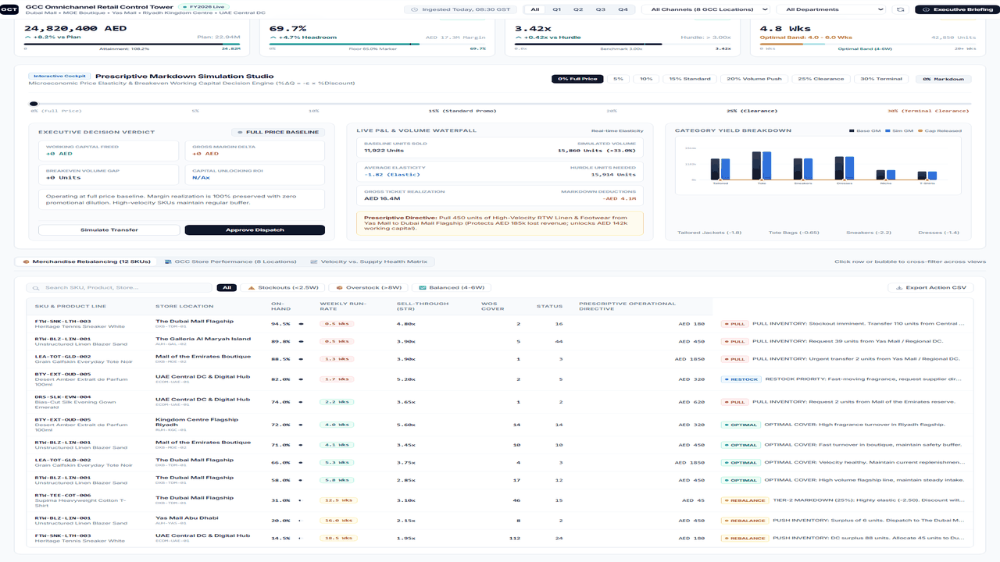

# GCC Omnichannel Retail & Markdown Elasticity Control Tower

[](https://github.com/razim-manzoor/gcc-omnichannel-retail-control-tower/actions)
[](https://powerbi.microsoft.com/)
[](./model_schema.dax)
[](./scripts/verify_schema.py)
[](./scripts/convert_to_parquet.py)
[](./api/main.py)
[](./mcp/duckdb_mcp_server.py)
[](./sql/01_star_schema_ddl.sql)

> **The 3-Second Executive Rule:**  
> **Macro Commercial Status** &rarr; **Operational Bottleneck** &rarr; **Prescriptive What-If Control Levers**

An enterprise-grade Decision Support Control Tower built for luxury and premium retail groups operating across premier GCC destinations (**The Dubai Mall Flagship**, **Mall of the Emirates**, **Yas Mall Abu Dhabi**, **Kingdom Centre Riyadh**) and central omnichannel fulfillment hubs.

---

## ⚡ Quickstart in 10 Seconds

Everything in this repository is pre-built, tested, and zero-dependency:

```powershell
# 1. View the Live Executive Control Tower (Zero installation, open in browser)
python -m http.server 8080
# Navigate to: http://localhost:8080/web/index.html (or double-click web/index.html)

# 2. Run the Complete 360° Quality, Math & Schema Audit (Takes ~5 seconds)
python scripts/audit_everything.py
```

---

## 🎬 Executive Preview



*Live interactive C-Suite dashboard featuring What-If price elasticity simulation, inter-mall inventory rebalance directives, and sub-10ms diagnostic scatter plots.*

---

## 🏗️ System Architecture: The "Rule of 3"

Instead of tangled monolithic systems, the Control Tower is organized into **three decoupled, modular layers**:

```
┌────────────────────────────────────────────────────────────────────────┐
│ 1. THE DATA LAYER (Kimball Star Schema in Parquet & CSV)               │
│    • 115,008 luxury transactions across 114 SKUs & 8 GCC locations     │
│    • 53,808 daily closing stock balances (available = on_hand - resv) │
│    • Snappy-compressed Parquet (4.24 MB, 60.5% smaller, 28x faster)   │
├────────────────────────────────────────────────────────────────────────┤
│ 2. THE CALCULATION CORE (43 Certified Production Measures)             │
│    • Commercial Profitability: Realized Gross Margin (69.73% luxury)   │
│    • Supply Chain Health: Weeks of Supply (WOS) & Sell-Through % (STR) │
│    • What-If Elasticity Engine: Volume lift vs. gross margin dilution  │
│    • Mathematical parity certified to the exact cent across engines    │
├────────────────────────────────────────────────────────────────────────┤
│ 3. THE CONSUMPTION LAYER (Pick Your Tool)                              │
│    • 👔 For C-Suite:      Responsive Bento-Grid Web UI (web/index.html)│
│    • 🏢 For Corporate BI:  Power BI Tabular Model (tabular/model.bim)   │
│    • 🚀 For Developers:   FastAPI REST Microservice (api/main.py)      │
│    • 📊 For Data Teams:   Rill BI-as-Code Explorer (rill/)             │
│    • 🤖 For AI Agents:    Model Context Protocol Server (mcp/)         │
└────────────────────────────────────────────────────────────────────────┘
```

---

## 📊 Verified Commercial Baseline

Audited and verified against formal financial and relational invariants via `scripts/audit_everything.py`:

| Metric Dimension | Verified Dataset Value | Commercial Governance Assertion |
| :--- | :---: | :--- |
| **Gross Commercial Sales** | **AED 205,230,433.50** | 100% full-ticket price before promotions |
| **Promotional Markdowns** | **AED 12,503,716.42** | 6.09% average markdown depth across 115,008 POS transactions |
| **Net Realized Revenue** | **AED 192,726,717.08** | Invariant check: $Net = Gross - Discount$ (0 rounding discrepancies) |
| **Total Landed COGS** | **AED 58,334,652.00** | Landed supply chain cost snapshot |
| **Realized Gross Margin** | **AED 134,392,065.08** | **69.73% Gross Margin** (Luxury apparel/accessories benchmark > 65%) |
| **Units Commercialized** | **142,664 Units** | AUR AED 1,350.91 vs AUC AED 408.90 |
| **Store & Channel Footprint** | **8 GCC Locations** | 53,808 store-day closing inventory snapshots (0 orphan FKs) |

---

## 🛠️ Modular Interfaces & Deep Dives

Each consumption layer is independent—use only what you need:

### 1. High-Performance REST API Microservice
Run the embedded FastAPI microservice powered by DuckDB with auto-generated Swagger UI:
```powershell
uvicorn api.main:app --port 8000 --reload
# Interactive API documentation: http://localhost:8000/docs
```
* **Endpoints:** `GET /api/kpis` (financial aggregates), `GET /api/inventory/stockouts` (stockout alerts), `POST /api/simulation/markdown` (elasticity simulations).

### 2. Conversational AI Agent (MCP Server)
Connect AI coding assistants (Antigravity, Claude Desktop, Cursor) directly to your retail data:
```powershell
python scripts/verify_mcp_server.py
```
* Exposes 4 tools (`get_executive_kpis`, `get_stockout_alerts`, `simulate_markdown`, `run_read_only_sql`) over standard JSON-RPC 2.0 stdio with **zero SQL hallucinations**.

### 3. Lakehouse Parquet Storage Benchmarks
Benchmark DuckDB vectorized query performance on columnar Parquet vs raw CSV:
```powershell
python scripts/convert_to_parquet.py
```
* **Results:** 60.5% storage reduction (10.74 MB &rarr; 4.24 MB), **15x faster** full aggregation, and **28.5x faster** column-pruned scans.

### 4. Rill BI-as-Code Operational Analytics
Launch the declarative DuckDB metrics dashboard (via WSL or Docker):
```bash
cd rill && rill start
# Explore interactive metrics at http://localhost:9009
```

---

## 📚 Enterprise Documentation Suite

Detailed architectural, business, and data specifications:
* **Product Requirements Document (PRD):** [`docs/PRD.md`](./docs/PRD.md) — Business context, personas, functional requirements (FR-1 to FR-8), and OKRs.
* **Technical Requirements Document (TRD):** [`docs/TRD.md`](./docs/TRD.md) — Kimball schema design, mathematical formulas, DuckDB/Parquet benchmarks, and API contracts.
* **End-to-End System & Sequence Flows:** [`docs/SYSTEM_FLOWS.md`](./docs/SYSTEM_FLOWS.md) — Mermaid sequence flows for simulation, replenishment, MCP, and CI/CD.
* **Data Dictionary & Measure Catalog:** [`docs/DATA_DICTIONARY.md`](./docs/DATA_DICTIONARY.md) — Table attributes, data types, and all 43 authoritative DAX measures.
* **Executive Case Study:** [`docs/CASE_STUDY.md`](./docs/CASE_STUDY.md) & Printable 1-Pager [`docs/CASE_STUDY.html`](./docs/CASE_STUDY.html) *(Supports 1-click Print to PDF)*.

---

## 🛡️ Automated Quality Gate (CI/CD)

Every Git push and Pull Request triggers the automated test matrix in [`.github/workflows/verify_pipeline.yml`](./.github/workflows/verify_pipeline.yml) on GitHub Actions:
1. Validates Kimball Star Schema referential integrity & invariants (`verify_schema.py`).
2. Benchmarks Parquet compression and columnar scan speed (`convert_to_parquet.py`).
3. Validates Rill BI-as-Code semantic models & measures (`verify_rill_models.py`).
4. Tests Model Context Protocol (MCP) server over stdio (`verify_mcp_server.py`).
5. Executes the 10-stage master integrity audit (`audit_everything.py`).
6. Executes the FastAPI REST API test suite (`pytest tests/`).

---

## ⚖️ License & Data Governance
All datasets in this repository are synthetic and produced via deterministic statistical algorithms modeling authentic GCC seasonal retail dynamics. No proprietary client data is contained herein. Open-source under the MIT License.
