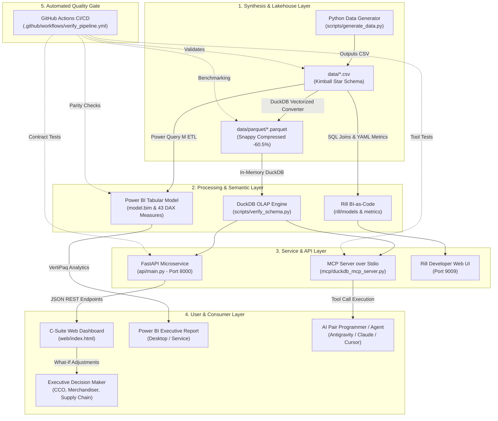
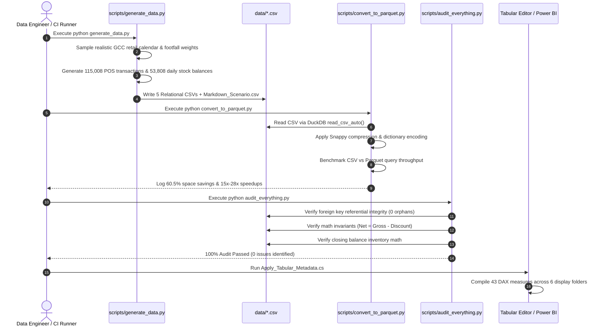
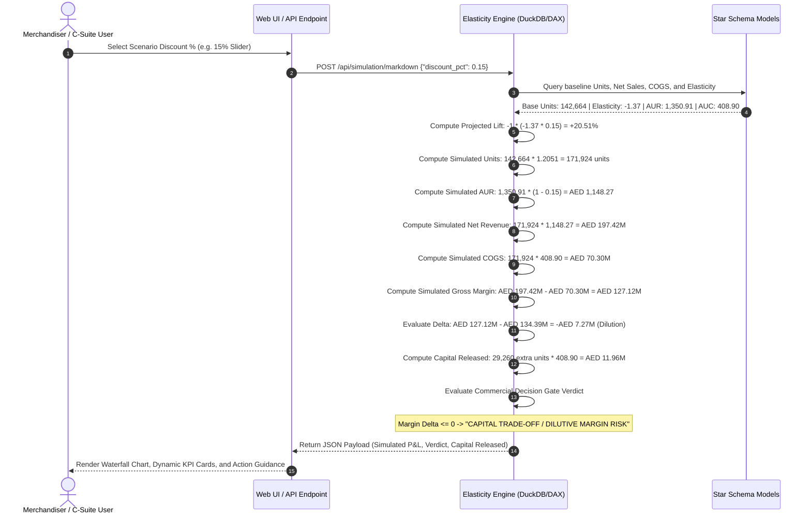
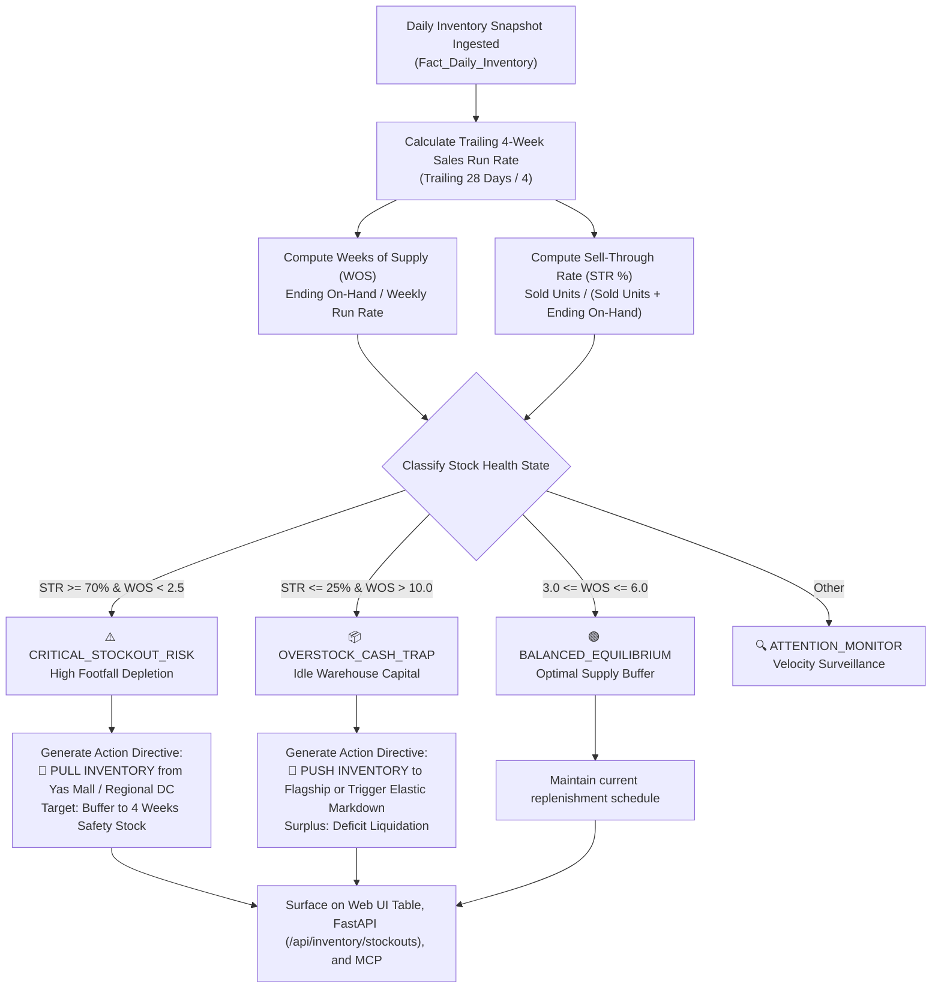
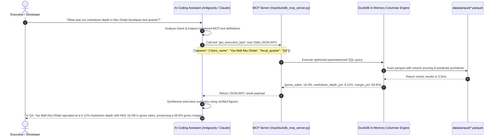
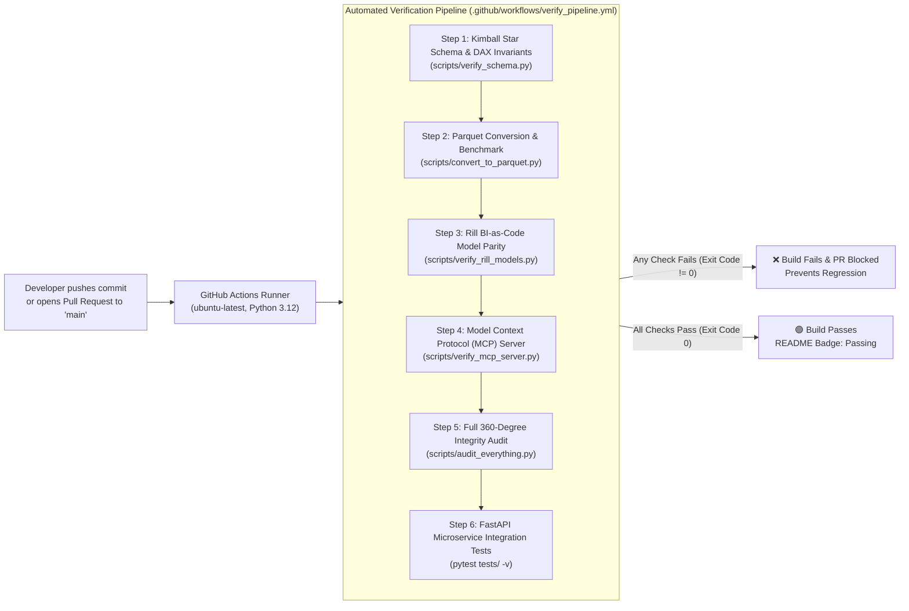

# 🔄 End-to-End System & Sequence Flows (SYSTEM_FLOWS.md)
## GCC Omnichannel Retail & Markdown Elasticity Control Tower

**Document Version:** 1.0.0  
**Status:** Production Verified  
**Diagram Format:** Mermaid Diagrams (Supported across GitHub, VSCode, Obsidian, and Markdown Viewers)

---

## 1. High-Level Architectural Landscape

---

## 2. Data Synthesis & Lakehouse Ingestion Pipeline Flow

---

## 3. What-If Markdown Elasticity Simulation Loop

---

## 4. Prescriptive Inter-Mall Stock Balancing Flow

---

## 5. Conversational AI Agent Interaction Flow (MCP)

---

## 6. Automated CI/CD Quality Assurance Gate

